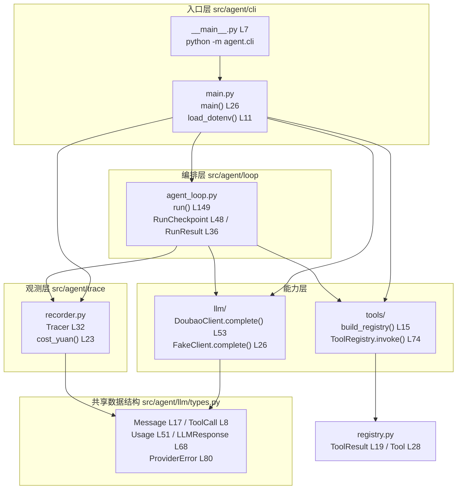
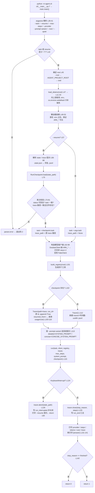
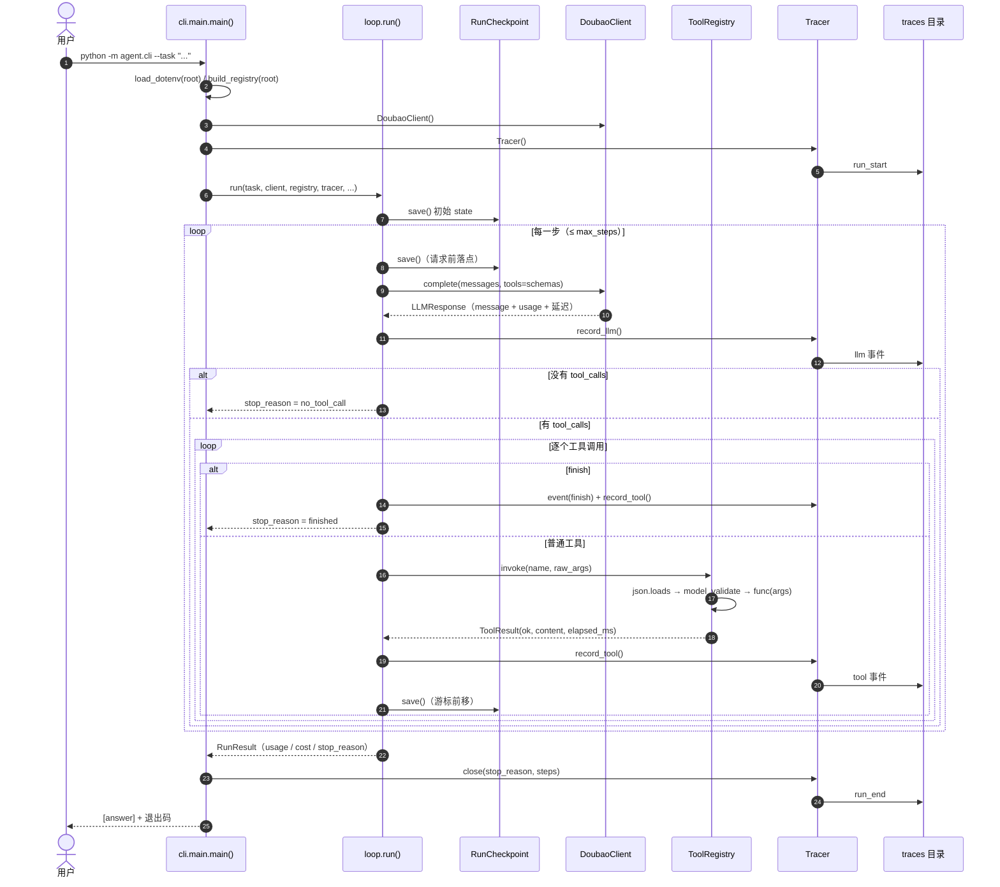
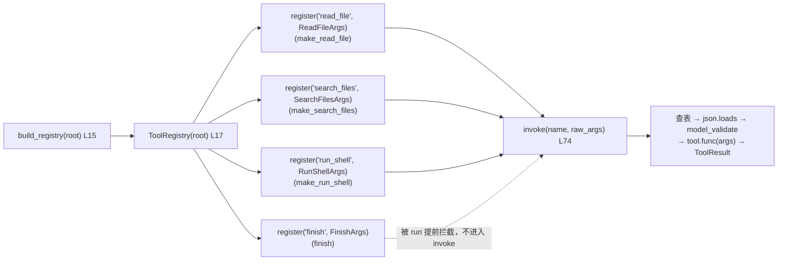
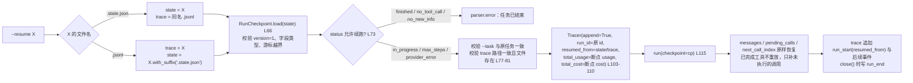
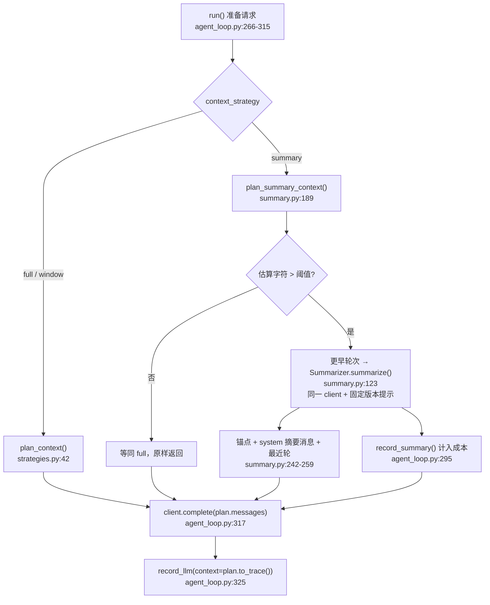

# ai_agent 代码执行流程与关键节点说明

- 分析对象：`src/agent`（A1 最小闭环）及其配套脚本、测试
- 代码基线：当前工作区 `main`，`src/agent` 下 18 个 Python 文件（含 `__init__`）、约 1200 行
- 行号基线：第 1 周分析时的 commit `9e2a833`。第 2 周加入上下文策略后，`cli/main.py`、
  `agent_loop.py`、`recorder.py` 的行号有变动，符号与主流程不变；第 2 周增量见第 10 节
- 核对方式：逐文件阅读调用关系，并用单测复核（当前 64 条通过）
- 阅读顺序建议：第 1 节看分层 → 第 2、3 节看主流程 → 第 5、6 节查函数 → 第 8、9 节看数据与边界

---

## 1. 仓库定位与分层

这是一个**不依赖 Agent 框架**的手写工具调用循环（见 [ADR 0001](../adr/0001-loop-without-framework.md)）。它只做四件事：

> 问模型 → 执行工具 → 回填结果 → 判断是否停止

整体是五层结构，依赖方向自上而下，`llm` 与 `tools` 互不感知：



| 模块 | 文件 | 职责 | 对外符号 |
| --- | --- | --- | --- |
| 入口 | `src/agent/cli/main.py` | 参数解析、`.env` 加载、provider/工具/tracer 装配、断点解析、结果打印与退出码 | `main()`、`load_dotenv()` |
| 编排 | `src/agent/loop/agent_loop.py` | 状态机主循环、停止判定、重复调用护栏、断点保存/恢复 | `run()`、`RunCheckpoint`、`RunResult` |
| 上下文 | `src/agent/context/` | 每次请求的消息装配：全量拼接与滑窗；不修改完整对话 | `plan_context()`、`ContextPlan` |
| 模型 | `src/agent/llm/` | 供应商适配（流式、usage、429 退避、错误归类）与离线替身 | `LLMClient`、`DoubaoClient`、`FakeClient` |
| 工具 | `src/agent/tools/` | 工具注册、schema 生成、参数校验、执行与错误归一化；四个只读工具 | `ToolRegistry`、`build_registry()`、`FINISH_TOOL` |
| 观测 | `src/agent/trace/recorder.py` | JSONL 事件落盘、token 累计、成本估算 | `Tracer`、`cost_yuan()` |
| 外部脚本 | `scripts/probe.py`、`press_429.py`、`replay.py` | 连通性四项自检、429 压测、trace 重放核对 | 独立 CLI |

**依赖注入的落点**：`run()` 只依赖 `LLMClient` 协议（`llm/base.py:10`）、`ToolRegistry`、`Tracer`
三个抽象，上下文装配收敛到纯函数 `plan_context()`，因此主循环无需知道用的是豆包还是
`FakeClient`，测试全部用离线替身跑通。

---

## 2. 一次运行的端到端流程（CLI 层）



### 2.1 装配阶段的函数调用

| # | 节点 | 函数（位置） | 调用方向 / 内部动作 | 作用 | 产出或副作用 |
| --- | --- | --- | --- | --- | --- |
| 1 | 进程入口 | `cli/__main__.py:7` | `sys.exit(main())` | 支持 `python -m agent.cli` | 进程以 `main()` 返回值退出 |
| 2 | 参数解析 | `cli/main.py:26-41` `main()` | `argparse.ArgumentParser.parse_args` | 收集任务、断点、步数上限（默认 `AGENT_MAX_STEPS` 或 12）、provider、提示版本、仓库根 | `args` 命名空间 |
| 3 | 环境加载 | `cli/main.py:11-23` `load_dotenv()` | `Path.read_text` → `os.environ.setdefault` | 从 root 向上找首个 `.env`，**不覆盖**已存在的进程变量 | 注入 `ARK_*` |
| 4 | 断点恢复 | `cli/main.py:57-81` | `RunCheckpoint.load()`（`agent_loop.py:66`） | 把 state 文件还原成对话、游标、待执行调用 | `RunCheckpoint` 实例或 `parser.error` |
| 5 | 模型装配 | `cli/main.py:92-99` | `DoubaoClient.__init__`（`doubao.py:27`）/ `FakeClient.__init__`（`fake.py:17`） | 校验密钥与模型 ID，创建 SDK 客户端（`max_retries=0`） | `client`，失败 `return 2` |
| 6 | 工具装配 | `cli/main.py:101` → `tools/__init__.py:15` `build_registry()` | `ToolRegistry.register()` ×4（`registry.py:45`） | 把工具名、描述、pydantic 参数模型、执行函数绑定在一起 | `ToolRegistry`（含 4 个工具） |
| 7 | 追踪装配 | `cli/main.py:103-112` | `Tracer.__init__`（`recorder.py:35`）→ `Tracer.event()` | 新建或追加 trace；恢复运行要继承历史用量与成本 | 打开 `traces/*.jsonl`，写入 `run_start` |
| 8 | 主循环 | `cli/main.py:115` → `agent_loop.py:149` `run()` | 见第 3 节 | 执行最多 `max_steps` 轮 | `RunResult` |
| 9 | 收尾计量 | `cli/main.py:129` → `recorder.py:102` `close()` | `Tracer.event("run_end", ...)` | 写入总 token、总成本、停止原因、步数 | 关闭文件句柄 |
| 10 | 结果输出 | `cli/main.py:131-142` | `print` | `--quiet` 只留结论；非 `finished` 一律退出码 1 | 退出码 |

> 关键细节：`main()` 在第 47 行先加载 `.env`，到第 49 行才**延迟导入** `llm/loop/tools/trace`。这样 `agent.cli.main` 可在无密钥、无网络的环境下被 `probe.py` 导入，也不会在模块导入期就构造 SDK 客户端。

---

## 3. 核心循环状态机（`run()`）

这是全仓最关键的一段代码（`src/agent/loop/agent_loop.py`，当前 L220-326；下图沿用第 1 周基线行号）。一句话概括：

> 每一"步"最多调用一次模型，然后顺序执行本步返回的全部工具调用；`finish`、重复调用、上游异常、步数耗尽四类情况负责终止。

> 第 2 周在"问模型"之前插入了 `plan_context()`（第 10 节），下图保留第 1 周基线，
> 差异只有"发给模型的消息由 `messages` 改为 `plan.messages`"，其余分支不变。

### 3.1 主流程图

```mermaid
flowchart TD
    S0["run() 入口 L149"] --> S1["初始化 L159-169<br/>messages = checkpoint.messages 或 [system, user]<br/>schemas = registry.schemas()<br/>恢复 last_key / repeats / pending_calls<br/>next_call_index / step / next_step"]
    S1 --> S2["checkpoint_path = trace.with_suffix('.state.json') L172"]
    S2 --> S3["定义 save_checkpoint(status) 闭包 L174-190<br/>用 tracer 的累计 usage/cost 构造 RunCheckpoint"]
    S3 --> S4{"新运行? L192"}
    S4 -- 是 --> S5["save_checkpoint() 落初始断点 L193"]
    S4 -- 否 --> S6["for current_step in range(next_step, max_steps+1) L195"]
    S5 --> S6

    S6 --> D1{"pending_calls 为空? L197"}
    D1 -- 是 --> D2["next_step = step<br/>save_checkpoint() L199-200<br/>（请求前落点：中断可安全重发）"]
    D2 --> D3["client.complete(messages, tools=schemas) L202"]
    D3 --> D4{"抛 ProviderError? L203"}
    D4 -- 是 --> E1["answer = '上游不可用：…'<br/>stop_reason = provider_error<br/>tracer.event('provider_error') L206<br/>save_checkpoint(status) L207"]
    D4 -- 否 --> D5["tracer.record_llm(step, model, resp) L210<br/>messages.append(resp.message) L211<br/>pending_calls = resp.message.tool_calls L212<br/>next_call_index = 0，save_checkpoint() L214"]
    D5 --> D6{"pending_calls 为空? L216"}
    D6 -- 是 --> E2["answer = resp.message.content<br/>stop_reason = no_tool_call<br/>next_step = step+1<br/>save_checkpoint(status) L221"]
    D6 -- 否 --> D7["for call_index in range(next_call_index, len(pending_calls)) L224"]
    D1 -- 否 --> D7

    D7 --> D8{"call.name == 'finish'? L226"}
    D8 -- 是 --> E3["answer = json.loads(arguments)['summary'] L229<br/>（解析失败则用原始串）<br/>stop_reason = finished<br/>tracer.event('finish') + record_tool L233-234<br/>清空 pending / 游标，next_step=step+1<br/>save_checkpoint(status) L238"]
    D8 -- 否 --> D9["重复检测 L241-244<br/>key = (name, arguments)<br/>key == last_key ? repeats+1 : 1"]
    D9 --> D10{"repeats >= 3? L245"}
    D10 -- 是 --> E4["answer = '连续 N 次调用同一工具…'<br/>stop_reason = no_new_info<br/>tracer.event('loop_guard') L248<br/>清空 pending，next_step=step+1<br/>save_checkpoint(status) L252"]
    D10 -- 否 --> D11["registry.invoke(name, arguments) L255<br/>内部：查表 → JSON 解析 → pydantic 校验 → 执行"]
    D11 --> D12["tracer.record_tool(ok, elapsed, content, args) L256<br/>messages.append(tool 消息)<br/>失败时加 'ERROR: ' 前缀 L259-266<br/>next_call_index = call_index+1<br/>save_checkpoint() L268"]
    D12 --> D13{"本步还有下一个 call? L224"}
    D13 -- 是 --> D7
    D13 -- 否 --> D14{"stop_reason 是 finished 或 no_new_info? L270"}

    E3 --> D14
    E4 --> D14
    D14 -- 是 --> FIN
    D14 -- 否 --> D15["pending_calls = []；next_call_index = 0<br/>next_step = step+1<br/>save_checkpoint() L272-275"]
    D15 --> D16{"外层循环还有下一步? L195"}
    D16 -- 是 --> D1
    D16 -- 否 --> E5["for-else：stop_reason = max_steps<br/>save_checkpoint(status) L277-278"]
    E1 --> FIN
    E2 --> FIN
    E5 --> FIN
    FIN["return RunResult L283-291<br/>answer / steps / stop_reason<br/>tracer.total_usage / cost_yuan(usage) / trace_path"]
```



### 3.2 文字版（不依赖 Mermaid 渲染）

```
run()
├─ 恢复或初始化 messages、工具 schema、游标、步号
├─ 保存初始 checkpoint（仅全新运行）
└─ for step in next_step .. max_steps:
   ├─ [A] pending_calls 为空 → 保存断点（请求前）→ 调模型
   │     ├─ 上游异常 → provider_error，记事件，存断点，结束
   │     ├─ 记 llm 事件、追加 assistant 消息、取 tool_calls、存断点
   │     └─ 无 tool_calls → no_tool_call，结束
   └─ [B] 顺序执行 pending_calls（从 next_call_index 开始）
         ├─ finish → 解析 summary → finished，记事件，存断点，结束
         ├─ 与上次同名同参 连续 3 次 → no_new_info，记 loop_guard，结束
         └─ 普通工具 → registry.invoke → 记 tool 事件 → 回填 tool 消息
                       → 游标前移 → 存断点
   └─ 未触发终止 → 清空本步调用，step+1，存断点，进入下一步
└─ 循环正常耗尽 → max_steps，存断点，返回结果
```

### 3.3 终止条件（`stop_reason`）全表

| stop_reason | 触发位置 | 触发条件 | 是否有答案 | CLI 退出码 | 能否 `--resume` |
| --- | --- | --- | --- | --- | --- |
| `finished` | `agent_loop.py:226-239` | 模型调用 `finish` 工具 | 是（`summary`） | 0 | 否（已结束） |
| `no_tool_call` | `agent_loop.py:216-222` | 模型只回文本、不请求工具 | 是（文本内容） | 1 | 否（已结束） |
| `no_new_info` | `agent_loop.py:245-253` | 同名同参数**连续** 3 次 | 是（护栏说明） | 1 | 否（已结束） |
| `provider_error` | `agent_loop.py:203-208` | `client.complete` 抛 `ProviderError` 子类 | 是（"上游不可用…"） | 1 | 是 |
| `max_steps` | `agent_loop.py:276-278` | 跑满 `max_steps` 步仍未终止 | 否（空串） | 1 | 是 |

### 3.4 断点保存时机（为什么不会重复执行工具）

断点写在四个位置，构成"可安全重放"的边界：

1. **请求模型之前**（`L199-200`）：`next_step = step`，若此时中断，恢复后会重发这次尚未得到响应的请求。
2. **拿到响应之后**（`L214`）：assistant 消息与 `tool_calls` 已入 `messages`，工具还没执行。
3. **每个工具执行之后**（`L268`）：`next_call_index` 已前移，恢复时只补做剩下的调用。
4. **每步结束 / 终止时**（`L275`、`L238`、`L252`、`L277`）：记录 `status` 与下一步位置。

因此 `RunCheckpoint` 里同时存在 `step`（当前步）与 `next_step`（下一步从哪开始），二者在"中断于模型请求前"时相等，这正是恢复去重的关键。

---

## 4. 运行时序（成功路径）



---

## 5. 循环内部节点与函数调用明细

| 阶段 | 节点 | 函数（文件:行） | 调用者 → 被调用者 | 作用 | 输出 / 副作用 |
| --- | --- | --- | --- | --- | --- |
| 初始化 | 会话装配 | `run()` `agent_loop.py:159-162` | CLI → `run` | 新任务建 `[system, user]`；恢复任务直接复用断点里的 `messages` | `messages` 列表（全链路唯一事实来源） |
| 初始化 | 工具声明 | `registry.schemas()` `registry.py:55` | `run` → 注册表 | 用 pydantic `model_json_schema()` 生成 4 个 function 定义 | `list[dict]`，随每次请求发送 |
| 初始化 | 游标恢复 | `run()` `agent_loop.py:164-169` | — | 从断点恢复 `last_key/repeats/pending_calls/next_call_index/step/next_step` | 决定从哪一步、哪个调用继续 |
| 断点 | 保存状态 | `save_checkpoint()` `agent_loop.py:174-190` → `RunCheckpoint.save()` `L117` | `run` → 文件系统 | 组装 version=1 的 JSON，先写 `.tmp` 再 `Path.replace` 原子替换 | `<run_id>.state.json` |
| 模型 | 发起请求 | `client.complete()` `agent_loop.py:202` | `run` → `DoubaoClient.complete()` `doubao.py:53` | 传消息与工具 schema，取完整响应（含 usage） | `LLMResponse` |
| 模型 | 流式聚合 | `_stream_once()` `doubao.py:75` | `complete` → 内部 | 逐 chunk 累积文本；按 `tool_calls[].index` 合并被切片的 id/name/arguments；取 usage 与首字节延迟 | `Message` + `Usage` + 延迟指标 |
| 模型 | 限流退避 | `complete()` `doubao.py:63-73` | 内部循环 | 仅对 `ProviderRateLimited` 按 1/2/4 秒重试，最多 4 次尝试 | `last_attempts`、`last_retry_delays` |
| 计量 | 记 LLM 事件 | `tracer.record_llm()` `recorder.py:59` | `run` → `Tracer` | 累加 usage，按当前费率算单次成本，写 `llm` 事件 | trace 一行；`total_usage`/`total_cost` 增长 |
| 分支 | 无工具调用 | `agent_loop.py:216-222` | — | 模型直接给结论时以 `no_tool_call` 结束 | `answer` = 文本 |
| 分支 | finish | `agent_loop.py:226-239` | `run` → `json`/`Tracer` | **不执行** `finish` 函数本身，只解析 `summary` 作为答案；记 `finish` 事件 | `stop_reason=finished`，清空调用 |
| 护栏 | 重复调用检测 | `agent_loop.py:241-253` | — | 只比较**相邻**调用的 `(name, arguments)`，连续 3 次即判定空转 | `loop_guard` 事件，`no_new_info` |
| 工具 | 执行工具 | `registry.invoke()` `registry.py:74` | `run` → `ToolRegistry` | 查表 → `json.loads` → `model_validate` → `tool.func(args)` | `ToolResult(ok, content, elapsed_ms)` |
| 工具 | 错误归一化 | `registry.py:88-94` | `invoke` 内部 | `ToolDenied` → "拒绝执行"；其他异常 → "执行失败：类型: 信息" | `ok=False` 的可读文本 |
| 回填 | 写工具消息 | `agent_loop.py:259-266` | `run` | 构造 `role="tool"` 消息，失败时前缀 `ERROR: `，用 `tool_call_id` 关联 | `messages` 追加一条 |
| 记账 | 记工具事件 | `tracer.record_tool()` `recorder.py:82` | `run` → `Tracer` | 记录工具名、参数、耗时、ok、前 300 字符预览 | trace 一行（不落完整输出） |
| 步进 | 停止判定 | `agent_loop.py:270-278` | — | `finished/no_new_info` 跳出；否则清空本步调用、步号 +1 | 下一轮或 `max_steps` |
| 结果 | 组装返回 | `agent_loop.py:283-291` | `run` → CLI | 用 tracer 累计用量算总成本 | `RunResult` |

---

## 6. 工具层调用细节

`build_registry()`（`tools/__init__.py:15`）在装配期就固定了仓库根目录，工具函数由工厂函数闭包捕获 `root`，因此后续调用不需要再传路径：



| 工具 | 参数模型 | 核心函数（位置） | 作用与关键约束 |
| --- | --- | --- | --- |
| `read_file` | `ReadFileArgs`（`fs.py:24`） | `_resolve()` `fs.py:37`、`make_read_file()` `fs.py:45` | 读仓库内文件片段；`offset` 起、`max_lines ≤ 200`；输出带 `行号|` 前缀与总行数头。`_resolve` 用 `resolve()` 后判断 `root in p.parents`，同时挡住 `..` 与符号链接逃逸 |
| `search_files` | `SearchFilesArgs`（`fs.py:30`） | `make_search_files()` `fs.py:63` | 按正则逐行搜索；**命中总数始终扫全量**，`hits` 只受 `limit` 限制；`summary=true` 时只回全量计数与按文件分布；跳过 `SKIP_DIRS`（`.git/.venv/__pycache__/traces/out` 等）与常见二进制后缀 |
| `run_shell` | `RunShellArgs`（`shell.py:31`） | `make_run_shell()` `shell.py:36`、`_cut()` `shell.py:20` | `shlex.split(posix=True)` 拆参；先拒 `DENIED_BINS`，再查 `ALLOWED_BINS = {git, rg, python, pytest, uv, ruff}`；`git push/reset/clean/rebase...` 单独拒绝；`subprocess.run(shell=False, cwd=root, timeout≤10)`；stdout/stderr 超 4000 字符显式标注"已截断" |
| `finish` | `FinishArgs`（`finish.py:8`） | `finish()` `finish.py:14` | 协议级完成标记。`run()` 在 `agent_loop.py:226` 先识别工具名并直接结束，**不会真正执行**这个函数；它的 schema 只是为了让模型能把结论结构化传回 |

> 安全边界需要明确：`run_shell` 的"白名单 + `shell=False`"防的是误操作（管道、重定向、删库类命令），不是操作系统级沙箱——`python -c` 仍可执行任意代码。`read_file/search_files` 的根目录约束才是硬边界。

---

## 7. 断点恢复流程



`RunCheckpoint` 字段与用途（`agent_loop.py:48-64`）：

| 字段 | 含义 | 恢复时的作用 |
| --- | --- | --- |
| `run_id` / `trace_path` | 本次运行标识与原 trace 路径 | 复用同一 trace 追加写入；CLI 校验路径一致 |
| `task` | 任务原文 | 恢复时作为任务描述，并校验与 `--task` 不冲突 |
| `messages` | 完整对话（OpenAI 结构序列化） | 直接作为下一次模型请求的上下文 |
| `step` / `next_step` | 当前步 / 下一步起点 | 请求前中断时两者相等，避免重复计步 |
| `pending_calls` / `next_call_index` | 本步模型要求但尚未执行的调用及游标 | 只补做游标之后的调用，已完成的不重放 |
| `usage` / `total_cost_yuan` | 累计 token 与成本 | 恢复后继续累加，`run_end` 汇总是全生命周期 |
| `last_key` / `repeats` | 上一次调用签名与连续重复次数 | 跨恢复继续做空转护栏 |
| `status` | `in_progress` 或某个 `stop_reason` | 已结束的状态禁止恢复 |

---

## 8. 数据流与持久化产物

### 8.1 内存中的数据结构

| 结构 | 位置 | 作用 |
| --- | --- | --- |
| `Message` | `llm/types.py:17` | 统一消息；`to_openai()`（L27）在适配边界转换，`role="tool"` 带 `tool_call_id` 供供应商关联结果 |
| `ToolCall` | `llm/types.py:8` | `id` / `name` / 原始 JSON 字符串 `arguments`（解析与校验交给工具层） |
| `Usage` | `llm/types.py:51` | 输入/输出/合计/缓存命中；`add()`（L60）累加 |
| `LLMResponse` | `llm/types.py:68` | 消息 + 用量 + `finish_reason` + 首字节/总延迟 + 尝试次数 |
| `ToolResult` | `tools/registry.py:19` | `ok` + `content` + `elapsed_ms` |
| `RunCheckpoint` | `agent_loop.py:48` | 可恢复运行的完整快照 |
| `RunResult` | `agent_loop.py:36` | 面向 CLI 的结论：答案、步数、停止原因、用量、成本、trace 路径 |

### 8.2 落盘产物

| 产物 | 路径 | 写入者 | 内容 |
| --- | --- | --- | --- |
| trace | `traces/<run_id>.jsonl`（可用 `--resume` 指定其他文件） | `Tracer.event()` 每事件 `flush` | 一行一个事件，见下表 |
| 断点 | 与 trace 同名的 `.state.json` | `RunCheckpoint.save()`（`.tmp` + `replace`） | version=1 的完整运行快照 |

`trace` 事件类型：

| kind | 写入位置 | 关键字段 | 用途 |
| --- | --- | --- | --- |
| `run_start` | `recorder.py:50` | `run_id`、`resumed_from` | 标记一次运行（含恢复）开始 |
| `llm` | `recorder.py:64-80` | `step`、`model`、`usage`、`attempts`、延迟、`cost_yuan`、`tool_calls` 名称 | 计量与性能分析 |
| `tool` | `recorder.py:92-100` | `step`、`name`、`arguments`、`ok`、`elapsed_ms`、`preview`(300 字符) | 工具执行审计 |
| `finish` | `agent_loop.py:233` | `step`、`answer` | 记录收尾结论 |
| `loop_guard` | `agent_loop.py:248` | `step`、`tool`、`repeats` | 记录空转拦截 |
| `provider_error` | `agent_loop.py:206` | `step`、`error` | 记录上游故障 |
| `run_end` | `recorder.py:104` | `total_cost_yuan`、`usage`、`stop_reason`、`steps` | 汇总（`replay.py` 依赖它核对） |
| `run_interrupted` | `recorder.py:119` | `state_path` | Ctrl+C 中断，可恢复 |

成本口径（`recorder.py:23-29`）：

```
cost = (非缓存输入 × ARK_PRICE_IN
      + 缓存命中输入 × ARK_PRICE_CACHED
      + 输出 × ARK_PRICE_OUT) / 1_000_000
```

价格每次调用现读环境变量（默认 0.8 / 3.2 / 0.016 元每百万 token），避免模块导入早于 `.env` 加载。`total_cost` 在 `record_llm` 里按单次用量累加，`RunResult.cost_yuan` 则用**累计** `Usage` 重算一次——两者在取整前应一致，`scripts/replay.py` 专门核对这个差值。

---

## 9. 设计要点与需要留意的边界

### 9.1 值得沿用的设计

1. **循环零框架依赖**：状态机只有约 140 行，四类停止条件一目了然；trace 格式自定，后续评测可直接复用（ADR 0001）。
2. **协议隔离**：`run()` 只认 `LLMClient.complete`，换供应商不动循环；`FakeClient` 让全部控制流可在无密钥、无网络条件下测试。
3. **schema 与校验同源**：工具参数只写一份 pydantic 模型，既生成模型可见的 JSON Schema，又做运行时校验，不会漂移。
4. **错误一律转成模型可读文本**：工具异常、越权、参数错误都变成 `ERROR:` observation 回填，模型可自我纠正，循环不崩（`test_loop.py:79` 有断言）。
5. **断点写在"请求前"而非"响应后"**：配合工具游标，做到恢复时不重发已完成调用（`test_loop.py:137` 覆盖 trace 与 state 两种入口）。
6. **可观测性与成本同源**：`record_llm` 一次调用同时产出用量、延迟、重试次数与成本，避免多处口径不一致。

### 9.2 边界与已知风险

| 项 | 说明 | 位置 |
| --- | --- | --- |
| 错误重试范围 | 只有 429 会退避重试；超时与其他异常直接抛给循环，`_stream_once` 末尾注释写的"其余按可重试错误抛出"与实际行为不符（仅措辞问题，行为本身是刻意的） | `doubao.py:62-73`、`doubao.py:133` |
| 非 `finished` 即失败 | `no_tool_call` 也可能给出了正确答案，但 CLI 仍返回 1；脚本/CI 需按 `stop_reason` 判断而不是只看退出码 | `cli/main.py:142` |
| `max_steps` 断点恢复要抬高上限 | 跑满步数时断点里 `next_step = max_steps + 1`；原样 `--resume` 会立即再次以 `max_steps` 结束，必须同时传更大的 `--max-steps` | `agent_loop.py:275-281` |
| 工具副作用不可重入 | 当前四个工具只读，重放无害；若第 2 周加入写文件工具，"中断后可能重复执行"会变成真问题 | `agent_loop.py:268` |
| 未捕获异常不写 `run_end` | 只处理了 `KeyboardInterrupt`（走 `abort`）；其他异常会跳过 `tracer.close()`，trace 缺少汇总行 | `cli/main.py:114-129` |
| 重复护栏只看相邻 | 模型交替使用"A、B、A、B"可以绕过 3 次阈值 | `agent_loop.py:241-243` |
| `SKIP_DIRS` 用绝对路径匹配 | `path.parts` 包含仓库父目录，若仓库本身位于名为 `out`/`traces` 的目录下，搜索会整体跳过（实测：把 pytest 临时根放到 `out/` 下，3 条 `search_files` 用例全部返回 0 命中） | `fs.py:74-77` |
| 规模上限 | `read_file ≤ 200` 行、`run_shell` 输出 4000 字符、`search_files` 明细 ≤ 60 条；超限都显式提示"截断/只列前 N"，但模型仍可能误读，系统提示里专门写了这条约束 | `fs.py:27`、`shell.py:16-17`、`agent_loop.py:18-19` |
| trace 未脱敏/未轮转 | 工具参数与输出预览会落盘，只适合本地调试 | `recorder.py:92-100` |

### 9.3 断言与脚本的对应关系

| 验证目标 | 入口 | 断言/判定位置 |
| --- | --- | --- |
| 正常收尾（finish） | `uv run python -m agent.cli --task ... --provider fake` | `tests/test_loop.py:17` |
| 空转护栏 | 同参数连续调用 | `tests/test_loop.py:42` |
| 上游故障 | `ProviderTimeout` / 不可达 `ARK_BASE_URL` | `tests/test_loop.py:61`、`scripts/probe.py:103` |
| 工具失败回填 | 故意抛异常的工具 | `tests/test_loop.py:79` |
| 纯文本回答 | 无 tool_calls 的响应 | `tests/test_loop.py:121` |
| 断点恢复不重放 | 第 4 次工具调用前中断 | `tests/test_loop.py:137` |
| 限流退避 | 本地 429 桩 / 真实压测 | `scripts/probe.py:154`、`scripts/press_429.py` |
| trace 自洽 | `uv run python scripts/replay.py --trace ...` | `scripts/replay.py:33` |

---

## 10. 第 2 周增量：上下文策略（2026-11-15 至 11-16）

第 2 周把"本次请求发哪些消息"从循环里拆成独立模块：`full`、`window`、`summary` 共用同一提示模板，
由 `--context-strategy` 一个参数切换；系统提示、工具 schema、工具执行与断点逻辑都不变。



### 10.1 三种策略与关键约定

| 策略 | 装配规则 | 说明 |
| --- | --- | --- |
| `full`（默认） | 原样返回全部 `messages` | 保持第 1 周行为，成本随步数线性增长 |
| `window` | 锚点（system + 首条 user）+ 最近 `window_turns` 轮 | 一轮 = 一条 assistant 响应及其**全部** tool 结果，整轮保留或整轮丢弃 |
| `summary` | 未超字符阈值时等同 `full`；超阈值时摘要更早轮次，锚点 + 摘要 system 消息 + 最近 `keep_turns` 轮 | 摘要调用同一模型、固定版本提示；阈值默认 12000 字符，保留 2 轮 |

- 只裁请求，不动会话：`messages`、`.state.json` 断点、`--resume` 仍基于全量历史。
- 锚点固定：窗口/摘要都保留 system 与任务原文，避免把任务本身裁掉。
- 配对完整：`drop_orphan_tools()` 兜底移除找不到父调用的 tool 消息，避免供应商拒收。
- 参数非法（窗口 < 1、未知策略、未知摘要版本、阈值 < 1）直接报错，不静默退化。
- 摘要失败可降级：本任务内停用摘要并改用 `window`，`summary_error` 事件记录失败及已消耗用量。

### 10.2 入口、断点与 trace

| 位置 | 变化 |
| --- | --- |
| `cli/main.py:39-63` | `--context-strategy {full,window,summary}`、`--context-window`、`--summary-version`、`--summary-threshold` |
| `cli/main.py:118-143` | 恢复时未显式指定策略/窗口/版本/阈值则沿用断点，随后统一校验 |
| `agent_loop.py:193-196` | `run()` 新增上下文与摘要参数，未指定时沿用断点或默认值 |
| `agent_loop.py:77-80` | `RunCheckpoint` 新增 4 个字段，保存于 `L174-177`，读取于 `L112-121` |
| `agent_loop.py:266-315` | 请求前选策略：summary 走 `plan_summary_context()`，失败降级 window，其余走 `plan_context()` |
| `agent_loop.py:295` | `record_summary()` 计入摘要调用成本，先落断点再发主请求 |
| `agent_loop.py:278` | `record_summary_error()` 记录失败事件与已消耗用量 |
| `recorder.py:60-83` | `record_llm(..., context=...)`；`context` 含 `strategy/total/used/dropped/window_turns/summary` |
| `recorder.py:85-116` | `record_summary()`：版本、覆盖条数、尝试次数、finish_reason、成本 |
| `recorder.py:118-156` | `record_summary_error()`：失败也把 token 计入总成本 |
| `summary.py:27-38` | `SUMMARY_PROMPTS` 固定版本：`v1` 当前，`v0` 回滚 |
| `summary.py:123-187` | `Summarizer.summarize()`：同 client、固定提示、按内容缓存、空正文翻倍重试 |
| `summary.py:189-281` | `plan_summary_context()`：阈值判断、摘要插入位置、保留最近轮 |
| `scripts/replay.py` | 打印上下文保留条数、摘要版本/覆盖/尝试次数与失败信息 |

### 10.3 评测与跑批

| 文件 | 作用 |
| --- | --- |
| `cases/context_cases.jsonl` | 50 条固定任务，四类 13/13/12/12，字段 `id/category/task/expect` |
| `scripts/check_cases.py` | 校验条数、字段、类别合法、ID 唯一与均衡性 |
| `scripts/run_cases.py` | 同一批任务按 `--strategy` 跑批，结果 JSONL 含 token/成本/步数/trace |
| `tests/test_context.py` | 策略边界、工具配对、CLI 切换、恢复继承 |
| `tests/test_summary.py` | 阈值触发、固定版本、缓存、空摘要重试、失败计费与降级 |
| `tests/test_cases.py` | 冻结评测集的契约 |
| `tests/test_run_cases.py` | 选择逻辑与 dry-run 不触发模型调用 |

一次批量运行的组合方式：

```text
run_cases.py --strategy full      → 每条用例一个 Tracer → 结果追加 JSONL
run_cases.py --strategy window --window 2 → 同一批任务换装配策略，指标可横向比较
run_cases.py --strategy summary --summary-threshold 3000 --summary-version v1
                                  → 摘要策略与版本同样逐条记录
```

### 10.4 摘要版本与回滚

| 版本 | 状态 | 提示特征 |
| --- | --- | --- |
| `v1` | 当前默认 | 300 字结构化要点，要求不编造、不写开场白 |
| `v0` | 旧版保留 | 150 字简版，用于 `--summary-version v0` 回滚对照 |

- 版本随 trace 与断点保存；恢复时未显式指定则沿用原版本。
- 摘要调用与主流程同一个 client/model，不挂工具；`max_tokens=800`，空正文且
  `finish_reason=length` 时翻倍到 1600 重试一次（上限 2000），两次用量合并计费。
- 摘要失败后本任务内停用摘要并降级 `window`，避免反复为空摘要付费。
- 摘要消息是 `system` 角色，插在锚点 system 之后、user 任务之前；只影响请求，不写回 `messages`。

第 2 周的局限：窗口按"轮"而不是 token 预算裁剪；摘要按请求重算而非滚动摘要，
长任务会多次调用；阈值是字符估算；`v0` 旧版提示在长上下文中更容易返回空正文。
相关性排序留给 11-17 BM25；也没有控制关键信息在上下文中的相对位置。

---

## 11. 一页速查

```
命令入口      python -m agent.cli --task/--resume
              └─ cli.main.main()  cli/main.py:26

装配顺序      load_dotenv → 断点解析 → client → registry → tracer → prompt
              （.env 必须先于 client 构造，见 cli/main.py:57-65）

上下文        --context-strategy {full,window,summary}（唯一开关）
              ├─ plan_context()        context/strategies.py:42
              │    window = system+首条user 锚点 + 最近 N 轮工具交互
              └─ plan_summary_context() context/summary.py:189
                   超阈值 → 同一模型按固定版本（v1/v0）摘要，可回滚

主循环        loop.agent_loop.run()  agent_loop.py:185
              ├─ 问模型   client.complete(plan.messages)  agent_loop.py:317
              ├─ 执行     registry.invoke()               agent_loop.py:375
              ├─ 回填     messages.append(tool)           agent_loop.py:379
              └─ 判断停   finish / no_tool_call / no_new_info /
                          provider_error / max_steps      agent_loop.py:390-398

四个工具      read_file / search_files / run_shell / finish
              tools/__init__.py:15-41

两类落盘      traces/<run>.jsonl   事件流（llm/tool/summary/finish/…）
              traces/<run>.state.json  断点（messages+游标+用量+策略/版本）

退出码        0=finished  1=其他停止原因  2=配置/参数错误  130=中断
```
